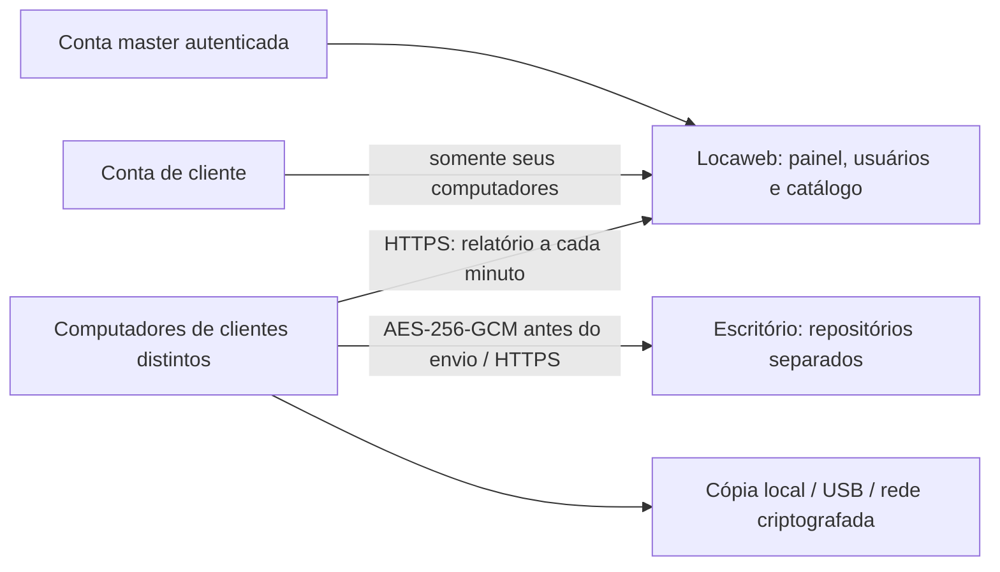

# Implantação: Locaweb + armazenamento no escritório

Esta versão entrega componentes testáveis, não provisiona uma conta Locaweb nem altera o roteador do escritório. Domínios, VPS, armazenamento, credenciais e conectividade ainda devem ser definidos pelo proprietário.

Para começar apenas com o painel online e backups locais/rede, siga o [passo a passo Locaweb](LOCAWEB-PASSO-A-PASSO.md). O receptor do escritório é opcional; não é requisito para relatórios.



## Plano recomendado

Contratar **VPS Linux**, sem painel de hospedagem compartilhada: **4 vCPU, 8 GB RAM e 80–100 GB SSD** é a recomendação para iniciar com vários clientes e folga operacional. Para um piloto pequeno, 2 vCPU / 4 GB RAM / 80 GB SSD pode atender. O VPS hospeda Node.js 24, SQLite em volume persistente, autenticação, relatórios e metadados; os conteúdos dos backups seguem diretamente para o escritório. Usar uma única instância do aplicativo com este SQLite, não múltiplas réplicas concorrentes em rede.

Página comercial: https://www.locaweb.com.br/servidor-vps/

Os nomes comerciais, preços, recursos exatos, snapshots e franquias precisam ser confirmados na contratação; não foi consultada uma cotação atual. Selecionar o plano equivalente aos recursos acima. Reservar verba para domínio, cópia externa do banco/chaves e monitoramento. Um plano de hospedagem de sites não substitui o VPS com Docker/Node e volumes persistentes.

## Capacidade e conexão do escritório

A carga inicialmente informada soma aproximadamente **4,35 TB**: sete desktops de 50 GB e dois servidores de 2 TB. Duas versões completas já requerem 8,7 TB antes dos diferenciais. Com um completo a cada janela de cinco dias, um mês pode conter cerca de cinco a seis completos: aproximadamente **22–26 TB só de completos**, além dos arquivos alterados nos diferenciais. Não há exclusão/retenção automática de backups nesta versão. Arquivos modificados, incluindo PST, são copiados por inteiro; a criptografia em blocos não é deduplicação ou diferencial por blocos.

Não dimensionar o escritório apenas pelo tamanho atual das pastas. Definir retenção e capacidade útil, considerando RAID, espaço livre, crescimento e cada cliente adicional. RAID não é cópia externa. O receptor usa uma cota padrão de 10 TiB por computador; o operador pode ajustar `max_bytes` em clients.json antes de reiniciar o serviço. A cota impede crescimento ilimitado e não apaga backups antigos.

Transferir os primeiros 4,35 TB exige, idealmente, cerca de quatro dias a 100 Mbit/s ou dez horas a 1 Gbit/s, antes de overhead, concorrência e limitações dos clientes. A banda necessária precisa comportar os próximos completos e diferenciais enquanto a fila anterior ainda existe. Para grandes cargas, uma carga inicial assistida e validação de capacidade são necessárias.

Os computadores precisam alcançar **HTTPS/443** no armazenamento. Preferir IP público/DNS do escritório. Se houver CGNAT, preparar um túnel seguro ou VPN; não expor SMB/445, RDP, SQLite ou pastas do servidor à internet. Evitar usar o VPS como retransmissor dos terabytes: isso consome sua franquia de tráfego. Se a rede exigir retransmissão, contratar tráfego compatível e dimensionar o túnel.

## Painel na Locaweb

Requisitos: VPS Linux atualizado, Docker Engine + Compose, DNS do painel apontando para seu IP e portas 80/443 disponíveis para Caddy emitir o certificado. A aplicação não publica a porta 3000 no host.

1. Obter o repositório e o instalador master **0.32.0** publicado em dist. O Dockerfile extrai dele o client genérico para o botão de download; nenhum instalador personalizado é publicado na imagem.
2. Copiar deploy/central.env.example para deploy/central.env. Preencher domínio, ADMIN_PASSWORD (senha longa e exclusiva) e KEY_ENCRYPTION_PASSWORD (senha longa da chave privada). Guardar o arquivo fora do Git, com permissão 600. As duas senhas têm funções diferentes.
3. Construir e iniciar:

```bash
docker compose --env-file deploy/central.env -f deploy/compose.central.yml up -d --build
```

4. Entrar pelo domínio HTTPS com admin e a senha inicial. O modo online desativa a sessão local automática. No botão Baixar client Windows, informar o nome exclusivo do computador. O endereço HTTPS do painel é incorporado automaticamente e o computador aparece no primeiro contato após instalar, sem cadastro de usuário/senha no client. Cada client recebe somente seu token de agente e a chave pública de recuperação.
5. Ao gerar cada client, baixar/anotar sua chave de segurança e guardá-la fora dos backups. Em Preferências > Geral, Mostrar/Baixar chave permite obter a chave de um computador já registrado. Mantenha também cópia externa do volume do master, com banco e carteiras.
6. Fazer cópia do volume control-data, incluindo banco e chaves. ADMIN_PASSWORD só cria o usuário inicialmente; alterar a variável não troca uma senha já cadastrada. Não apagar/recriar o volume para atualizar.

Os relatórios usam HTTPS autenticado pelo token do computador, com eventos de backup, heartbeat e confirmação do escritório. São mantidos em SQLite e arquivos JSONL sob DATA_DIR/telemetry/CLIENTE/COMPUTADOR/data.jsonl. Receber um relatório não comprova sozinho a integridade de todos os backups: cada execução confirma sua cópia e o receptor confirma separadamente os objetos recebidos. Cinco minutos sem relatório são sinalizados no painel. Não há verificação de recuperação lógica do Outlook nem alertas por email nesta versão.

A autenticação usa scrypt com sal individual, migra hashes anteriores após login válido, expira sessões remotas em oito horas e limita tentativas de login. Antes de produção comercial, validar firewall, atualização, cópias do banco/chaves, auditoria de acesso, proteção da conta master e testes de restauração completos. MFA, rotação/revogação abrangente de credenciais, retenção automática e operação autônoma do agendamento durante indisponibilidade do painel remoto ainda precisam de uma etapa específica. O agendamento atual depende do master configurado; a fila de relatórios e os envios do escritório não substituem uma engine local offline completa.

## Receptor no escritório

A receita Docker é para Linux. O código Node também é portável, mas serviço automático, disco e HTTPS precisam ser configurados conforme o sistema real do escritório. Para Windows, definir a estratégia de serviço/Docker antes de instalar em produção.

1. Escolher um volume físico com capacidade planejada. Criar a pasta, de propriedade do UID/GID 1000 usado pelo container, com permissão restrita.
2. Copiar deploy/office.env.example para deploy/office.env e preencher OFFICE_DOMAIN e OFFICE_STORAGE_PATH.
3. Construir o receptor:

```bash
docker compose --env-file deploy/office.env -f deploy/compose.office.yml build office
```

4. Para cada computador, copiar seu ID mostrado em Preferências e cadastrar um token exclusivo. O nome do cliente separa o repositório físico:

```bash
docker compose --env-file deploy/office.env -f deploy/compose.office.yml run --rm office node office-receiver.mjs --enroll cliente-a ID_DO_COMPUTADOR
```

O comando imprime uma credencial uma única vez. Inserir esse token em Preferências > Servidor do escritório, junto com seu endereço HTTPS, no computador correspondente. Não enviar tokens em chat, email ou Git. O receptor mantém somente o hash do token. Não reutilizar uma identificação para várias máquinas.

5. Iniciar os serviços:

```bash
docker compose --env-file deploy/office.env -f deploy/compose.office.yml up -d
```

6. Ativar o envio nas preferências e executar backup de teste. Confirmar separadamente o sucesso local, o recibo do escritório e uma restauração. Desconectar/reconectar a rede para validar a retomada. O receptor não possui endpoint para apagar versões confirmadas nem substituir seu conteúdo.

Os dados ficam em OFFICE_STORAGE_PATH/tenants/CLIENTE/BackupDesk/COMPUTADOR/ROTINA/EXECUÇÃO. O receptor não recebe chaves privadas e não descriptografa arquivos. Objetos são enviados em blocos de até 4 MiB, com SHA-256, posição de retomada e confirmação do conjunto completo. Pastas pendentes só se tornam versões disponíveis após o commit. Cotas e erros mantêm a cópia local e a fila, sem confirmação falsa.

Para recuperar no escritório nesta etapa, usar o repositório completo por um acesso administrativo seguro/montagem local/VPN e Abrir outro local na ferramenta; usar Restaurar arquivos de terceiro com nome e chave de segurança. O receptor permite leitura autenticada de objetos de cada computador, mas ainda não há uma experiência completa de navegação/restauração remota pela internet no painel. Não disponibilizar a árvore física publicamente.

## Sequência recomendada de ativação

1. Instalar a atualização em ambiente de teste e guardar a chave de segurança de cada computador.
2. Contratar/configurar VPS e domínio; validar isolamento de quatro contas/clientes.
3. Preparar conectividade, disco e HTTPS no escritório; cadastrar computadores.
4. Testar uma cópia local + escritório, queda de rede, retomada e recuperação em outra instalação.
5. Definir retenção, capacidade, alertas, recuperação de desastre e auditoria antes de ampliar para dados de produção.
